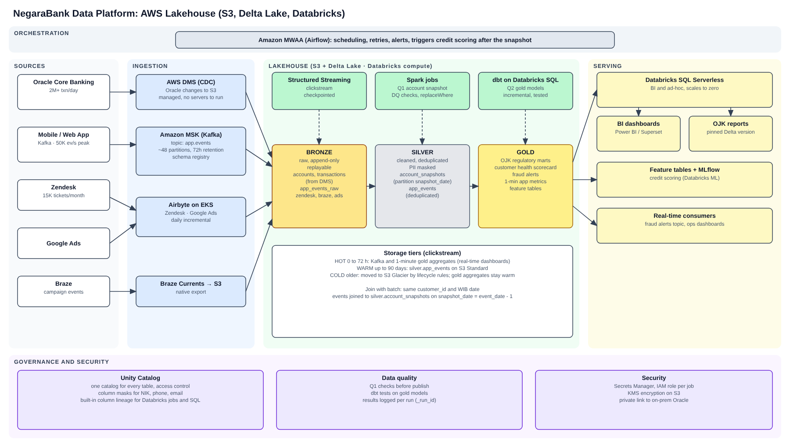

# Q3: Arsitektur platform

## (g) Arsitektur

Sehari-hari saya kerja di GCP (Pub/Sub, Composer, Dataform, BigQuery), jadi desain ini saya susun dengan padanannya di AWS: MSK untuk Pub/Sub, MWAA untuk Composer, dbt yang mirip Dataform. Prinsip saya sederhana: pakai sesedikit mungkin tool. Setiap tool tambahan berarti satu tempat lagi yang harus dijaga, dibayar, dan diperiksa saat audit OJK. Karena credit scoring sudah jalan di Databricks, semuanya saya taruh di satu lakehouse di sana.

### Alur data

Diagram dibaca dari kiri ke kanan. Ada empat jalur data.

**1. Core banking (batch, tiap malam).**
1. AWS DMS membaca perubahan dari log Oracle sepanjang hari dan menulisnya ke bronze di S3 (`accounts`, `transactions`).
2. Jam 00:30 WIB Airflow menunggu batch akhir hari Oracle selesai, lalu menjalankan job Spark Q1.
3. Job Q1 membangun `silver.account_snapshots` untuk hari itu. Kalau pengecekan datanya gagal, tidak ada yang ditulis.
4. Setelah snapshot siap, Airflow memicu job credit scoring dan model dbt dari Q2 untuk membangun tabel gold (scorecard, alert fraud).
5. Dashboard BI dan laporan OJK membaca tabel gold lewat Databricks SQL.

**2. Clickstream aplikasi mobile (streaming).**
Aplikasi mengirim event ke Kafka (MSK). Spark Structured Streaming menulis event mentah ke bronze, lalu membersihkannya ke `silver.app_events`, lalu membuat agregat per menit dan per jam di gold untuk dashboard real-time. Detailnya ada di bagian (h).

**3. Zendesk, Google Ads, Braze (batch harian).**
Zendesk dan Google Ads masuk lewat Airbyte, Braze lewat ekspor S3 bawaannya. Setelah masuk bronze, prosesnya sama dengan data core banking: dbt membersihkan ke silver lalu ke gold.

**4. Credit scoring.**
Job credit scoring membaca fitur dari silver dan gold, lalu menulis skornya sebagai tabel. Skor ini yang dipakai scorecard Q2 (`probability_of_default`).

Untuk semua jalur, akses dan masking NIK, telepon, dan email diatur di Unity Catalog. Data juga dicek dulu sebelum dipublish (pengecekan di Q1 dan test dbt di Q2).

### Kenapa memilih komponen ini

| Lapisan | Pilihan | Kenapa |
|---|---|---|
| Ingestion Oracle | AWS DMS dengan CDC, ke S3 (bronze) | Dikelola AWS, jadi tidak ada server tambahan. CDC membaca dari log database, jauh lebih ringan untuk core banking dibanding baca penuh tiap malam seperti job lama di Q1 |
| Clickstream | Amazon MSK (Kafka), dibaca Spark Structured Streaming | Aplikasi sudah mengirim event ke Kafka, jadi tinggal pakai versi terkelolanya |
| Zendesk, Google Ads | Airbyte | Konektornya sudah ada dan datanya kecil, tidak perlu bikin sendiri |
| Braze | Ekspor Braze Currents ke S3 | Braze bisa langsung ekspor ke S3 |
| Penyimpanan | Delta Lake di S3: bronze, silver, gold | Bisa overwrite per partisi (dipakai di Q1) dan punya time travel, jadi kita bisa menunjukkan isi laporan pada tanggal tertentu kalau OJK bertanya |
| Pemrosesan | Databricks (job Q1, streaming) dan dbt di Databricks SQL (Q2) | Satu platform dengan credit scoring |
| Orkestrasi | Amazon MWAA (Airflow terkelola) | Saya sudah terbiasa dengan Airflow, dan job-nya tidak hanya di Databricks (cek Oracle, Airbyte, dbt) |
| Serving | Databricks SQL untuk BI dan laporan OJK; feature table dan MLflow untuk credit scoring | Alat BI cukup pakai koneksi SQL biasa, dan SQL serverless tidak ditagih saat tidak dipakai |
| Governance | Unity Catalog | Izin akses, masking, dan lineage ada di satu tempat |
| Keamanan | Secrets Manager, IAM role per job, enkripsi KMS, koneksi privat ke Oracle | Password tidak ada di kode, setiap job hanya bisa akses yang dia butuhkan, dan data tidak lewat internet publik |

### Budget

Ini perkiraan kasar saya per bulan, belum saya cek ke kalkulator harga AWS dan Databricks:

| Item | USD |
|---|---|
| Databricks (job, streaming, SQL) dan EC2-nya | 22.000 |
| MSK (Kafka) | 5.000 |
| DMS, Airbyte, MWAA | 4.000 |
| Penyimpanan S3 | 4.000 |
| Jaringan, monitoring, lisensi BI | 6.000 |
| Total | 41.000 |

Masih ada sisa sekitar 9.000 dari budget 50.000. Kalau biayanya naik, yang pertama saya lakukan: pakai spot instance untuk job batch, pastikan cluster mati setelah job selesai, dan pindahkan data lama ke storage yang lebih murah dengan lifecycle rule S3.

## (h) Clickstream 50 ribu event per detik

Topik Kafka `app.events` saya beri sekitar 48 partisi dengan retensi 72 jam. Hitungannya kasar: kalau satu event sekitar 1 KB, puncaknya sekitar 50 MB per detik, dan 1 MB per detik per partisi masih aman. Angka pastinya perlu dicek dengan load test. Key-nya `session_id`, supaya event dalam satu sesi tetap urut.

Dari Kafka, data masuk ke tiga lapisan:
- **Bronze:** event mentah ditulis ke Delta kira-kira tiap 30 detik, tanpa diubah apa pun. Kalau ada bug di tahap berikutnya, data bisa diproses ulang dari sini.
- **Silver:** parse JSON, buang duplikat berdasarkan `event_id` (aplikasi mobile sering kirim ulang event saat koneksi jelek), ubah waktu ke WIB, tambah `event_date`, dan masking data pribadi.
- **Gold:** agregat per menit dan per jam, misalnya jumlah pengguna aktif dan funnel transfer.

Untuk join dengan data batch Q1, kedua tabel memakai `customer_id` dan tanggal WIB yang sama. Saya join dengan `snapshot_date = event_date - 1`, karena snapshot suatu hari baru jadi setelah tengah malam. Kalau pakai tanggal yang sama, kita memakai data yang belum ada saat event terjadi.

Penyimpanannya dibagi tiga:

| Tier | Umur data | Lokasi | Dipakai untuk |
|---|---|---|---|
| Hot | 0 sampai 72 jam | Kafka dan tabel gold per menit | Dashboard real-time |
| Warm | sampai 90 hari | `silver.app_events` di S3 Standard | Analisis dan fitur ML |
| Cold | lebih dari 90 hari | S3 Glacier lewat lifecycle rule | Audit dan proses ulang. Agregat gold harian dan bulanan tetap di warm karena kecil dan sering dipakai |

## (i) Lineage per kolom

Targetnya, untuk angka apa pun di dashboard OJK, kita bisa tunjukkan kolom sumbernya dan job yang membuatnya.

- **Di dalam Databricks (bronze sampai gold):** Unity Catalog mencatat lineage per kolom untuk job dan query yang membaca dan menulis tabel Unity Catalog. Setahu saya ini otomatis tanpa setup tambahan, tapi detailnya perlu saya cek lagi di dokumentasi Databricks. Ini mencakup job Q1 dan model dbt Q2.
- **Oracle ke bronze:** DMS menyalin tabel Oracle satu ke satu, jadi pemetaannya sederhana. Saya catat di komentar tabel dan kolom bronze, misalnya "source: CORE.ACCOUNTS.BALANCE".
- **Dashboard BI:** dashboard yang query lewat Databricks SQL muncul sebagai turunan tabel gold. Kalau alat BI-nya tidak tercatat otomatis, saya dokumentasikan secara manual dashboard mana memakai tabel gold mana.

Hubungannya dengan pipeline Q1:
- Job Q1 dijalankan di cluster Unity Catalog dan membaca/menulis tabel Unity Catalog, supaya lineage-nya tercatat.
- Setiap kolom output di kode Q1 diberi nama eksplisit (tidak pakai `agg({...})`), jadi di lineage terlihat jelas `closing_balance` berasal dari `ACCOUNTS.BALANCE` dan `net_amount` dari `TRANSACTIONS.AMOUNT`.
- Setiap baris menyimpan `_run_id` dan `_processed_at`, jadi bisa ditelusuri ke run Airflow yang menulisnya.
- Karena tabelnya Delta, versi data yang dipakai untuk sebuah laporan bisa di-query lagi dengan `VERSION AS OF`.